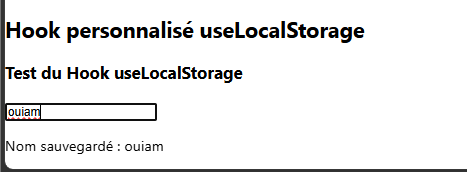
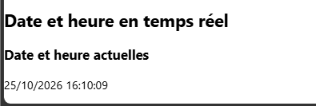

# TP 6 : Découverte des Hooks Avancés et des Hooks Personnalisés

## 1. Structure du projet

Le projet contient plusieurs composants React permettant de découvrir les Hooks avancés et les Hooks personnalisés, notamment useReducer, useRef, useEffect et useFetch.

## 2. Résultat final avant les exercices facultatifs

L’application affiche un compteur interactif, un champ de saisie utilisant useRef, un compteur de rendus, une liste d’articles récupérés depuis une API et un chronomètre utilisant useEffect.

3. Exercices facultatifs

Exercice 1 : Réinitialiser le compteur

Un bouton Réinitialiser a été ajouté au compteur. Il permet de remettre la valeur du compteur à zéro grâce à useReducer.

https://github.com/user-attachments/assets/0ebce022-5e00-49c8-ae7c-bd2badf8887f

Exercice 2 : Hook personnalisé useLocalStorage

Un Hook personnalisé useLocalStorage a été créé pour sauvegarder une valeur dans le stockage local du navigateur. La valeur saisie reste disponible après le rechargement de la page.

Exercice 3 : Afficher la date et l’heure

Un composant utilisant useEffect a été ajouté pour afficher la date et l’heure actuelles. L’affichage est mis à jour toutes les secondes grâce à setInterval, puis l’intervalle est nettoyé avec clearInterval.

